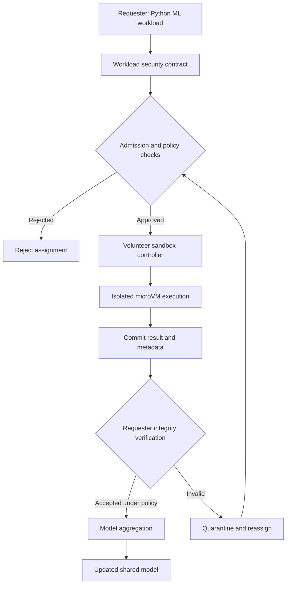
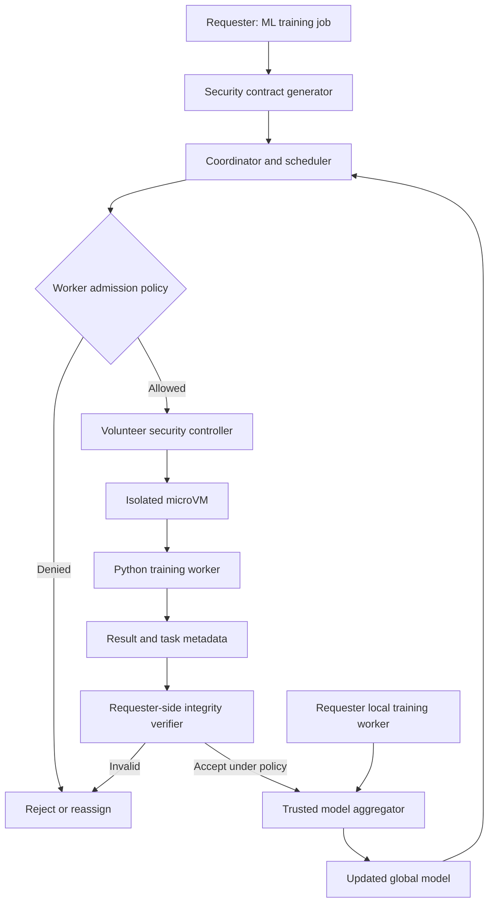
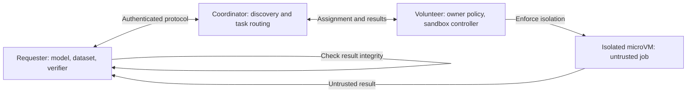
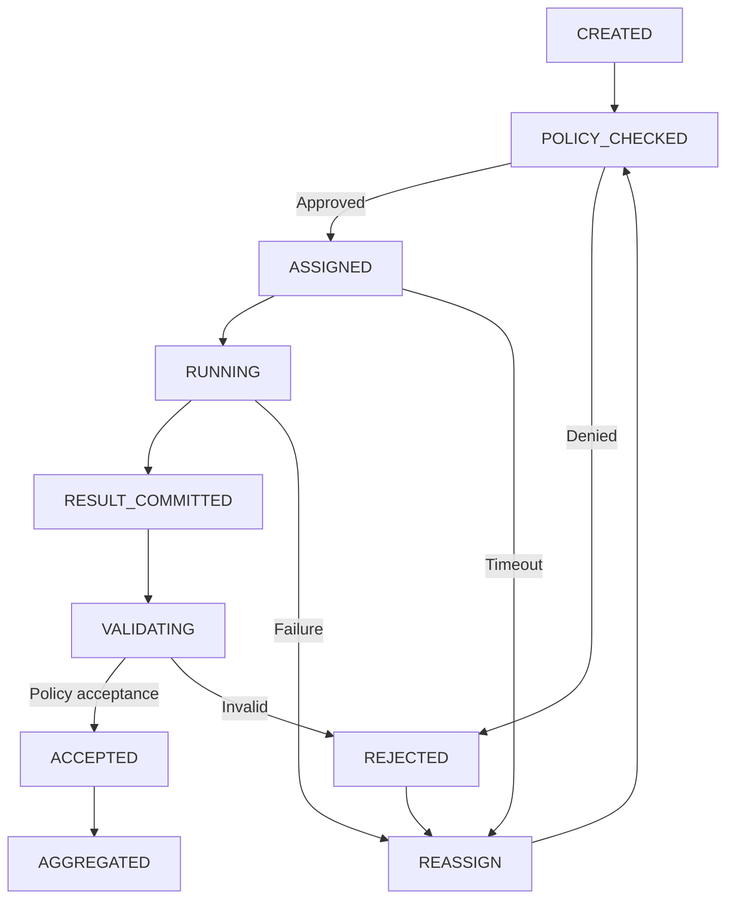
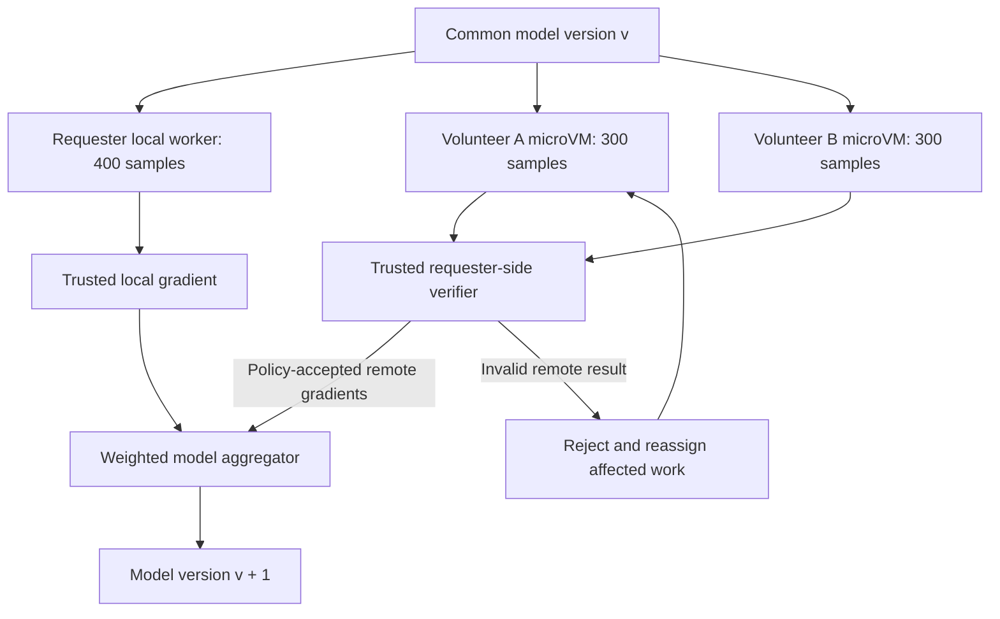
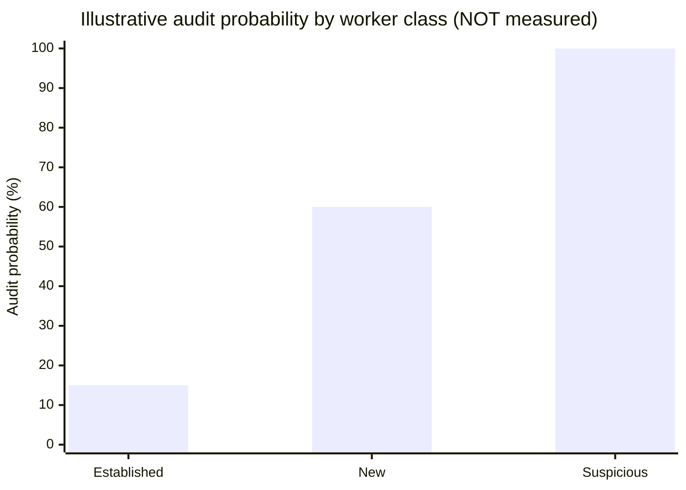
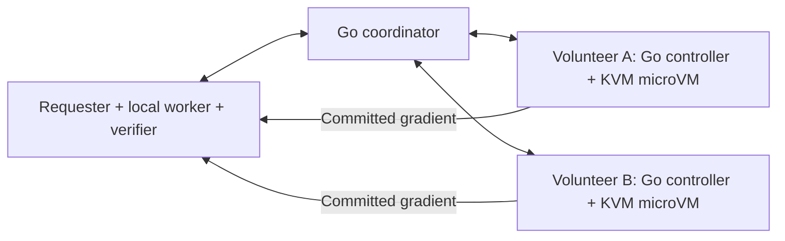

# VIT Invention Disclosure (IDF-B) — Consolidated Capstone Draft

**Working invention title:** System and Method for Secure, Adaptive Collaborative Computation Across Mutually Untrusted Consumer Devices  
**Proposed protocol:** Mutual-Trust Compute Protocol (MTCP)  
**Initial application:** Collaborative Python-based machine-learning training with a requester and multiple volunteer consumer computers  
**Prepared:** 26 October 2026  
**Source template:** *Invention Disclosure Format (IDF)-B*, VIT IPR & TT Cell, Document No. 02-IPR-R003, Issue 2/01.02.2024  
**Document status:** Research-stage draft; not an issued patent, validated implementation, or patentability opinion.

> **How to use this file:** Sections 1–7 are drafted in the order of the original VIT form. Section 8 links measured prototype results; Sections 9–10 retain their provisional assessment status. Technical figures appear as Mermaid diagrams (rendered by GitHub and many Markdown editors); their complete source code is embedded here, so no separate image files are required. The appendices preserve technical analyses, example contracts, pseudocode, experiment designs, proposed metrics, alternatives, and outstanding decisions from our discussion.
>
> **Integrity note:** Architectures, algorithms, threat mitigations, and example percentages below remain **proposed** unless explicitly identified as implemented or measured in Section 8 and its linked evidence. Local isolation/protocol checks and CIFAR training experiments have now been completed with their stated scope. Novelty has not been proven. The Indian patent search portal was identified, but CAPTCHA prevented a complete portal search during our earlier review. The prior-art table is preliminary and requires a full claim-level search.

## Table of contents

- [1. Title of the Invention](#1-title-of-the-invention)
- [2. Field / Area of Invention](#2-field--area-of-invention)
- [3. Prior Patents and Publications from Literature](#3-prior-patents-and-publications-from-literature)
- [4. Summary and Background of the Invention](#4-summary-and-background-of-the-invention-address-the-gap--novelty)
- [5. Objectives of the Invention](#5-objectives-of-the-invention)
- [6. Working Principle of the Invention](#6-working-principle-of-the-invention-in-brief)
- [7. Detailed Description of the Invention](#7-description-of-the-invention-in-detail)
- [8. Experimental Validation Results](#8-experimental-validation-results)
- [9. Aspects Requiring Protection](#9-what-aspects-of-the-invention-need-protection--provisional)
- [10. Technology Readiness Level](#10-technology-readiness-level--to-be-assessed)
- [Appendix A. Threat Model and Guarantees](#appendix-a-threat-model-and-security-guarantees)
- [Appendix B. Workload Security Contract](#appendix-b-workload-security-contract)
- [Appendix C. Algorithms, States and Trust Boundaries](#appendix-c-algorithms-states-and-trust-boundaries)
- [Appendix D. Worked Distributed-Training Example](#appendix-d-worked-example-three-machines-training-one-model)
- [Appendix E. Verification Policy and Graphs](#appendix-e-adaptive-verification-policy-and-illustrative-graphs)
- [Appendix F. Implementation Plan](#appendix-f-proposed-implementation-stack-and-prototype)
- [Appendix G. Experimental Plan](#appendix-g-experimental-evaluation-plan)
- [Appendix H. Prior-Art Sources](#appendix-h-reference-links-and-patent-search-notes)
- [Appendix I. Draft Evolution and Remaining Questions](#appendix-i-draft-evolution-status-and-open-questions)

---

# VIT IDF-B — Sections for the Form

## 1. Title of the Invention

**System and Method for Secure, Adaptive Collaborative Computation Across Mutually Untrusted Consumer Devices**

The title emphasizes the primary research contribution—security in consumer compute sharing—rather than limiting the invention to training machine-learning models. Machine learning is the first validation workload, not necessarily the only future application.

**Earlier working title (superseded when security became the focus):** A System and Method for Transparent and Adaptive Collaborative Machine Learning Training Across Heterogeneous Consumer Devices.

## 2. Field / Area of Invention

The proposed invention falls within the fields of Distributed Computing, Computer System Security, Virtualization, Parallel Processing, Heterogeneous Computing, Edge Computing, Secure Computation, and Distributed Machine Learning.

More specifically, the invention concerns a software-based system for enabling collaborative execution of computational workloads across geographically or locally distributed consumer-grade computing devices belonging to mutually untrusted parties. The proposed system combines workload-specific security policies, volunteer-side isolated execution, requester-side result-integrity verification, and security-aware task coordination.

The initial application focuses on Python-based machine-learning training workloads. The requester's local machine and multiple remote consumer devices collaboratively contribute toward training a common model, while the system accounts for computational-resource limits, communication overhead, execution security, participant availability, and computational-result integrity.

### Initial scope and boundaries

- **Included:** Consumer laptops/desktops/lab PCs; CPU-first Python workloads; local + multiple remote machines; volunteer permission and isolation; authenticated task metadata; independent result auditing; failure recovery.
- **Excluded from initial guarantees:** Confidentiality of arbitrary plaintext against a malicious volunteer host; complete protection from a compromised host operating system or hypervisor escape; GPU passthrough and hardware-backed confidential computing; arbitrary unsandboxed code; perfect detection of malicious machine-learning updates.
- **Longer-term ecosystem ideas, outside the core invention:** Credits, incentives, marketplace, decentralized discovery, and peer-to-peer operation.

## 3. Prior Patents and Publications from Literature

### 3.1 Preliminary prior-art comparison

| Prior patent / publication | What the prior art establishes | Significance for proposed MTCP |
|---|---|---|
| **BOINC** — Anderson; volunteer computing literature | Volunteer computing on independently owned devices, work-unit distribution, result validation, replication, and reliability management. | Consumer compute sharing and result replication are **not new**. Any distinction must be more specific than using idle PCs or adaptively checking results. |
| **MAUI** — Cuervo et al. (2010), *Making Smartphones Last Longer with Code Offload* | Cost-aware, program-level remote execution decisions. | Automatic offloading and reasoning about communication cost are established ideas. |
| **Dask** — Rocklin (2015), *Dask: Parallel Computation with Blocked Algorithms and Task Scheduling* | Python task graphs, distributed execution, and dynamic scheduling. | Parallel Python task distribution alone cannot establish novelty. |
| **Ray** — Moritz et al. (2018), *Ray: A Distributed Framework for Emerging AI Applications* | General-purpose distributed Python tasks and actors. | Scheduling and remote Python execution are established. |
| **DeDLOC** — Diskin et al. (2021), *Distributed Deep Learning in Open Collaborations* | Heterogeneous and unreliable collaborative model training. | Training one model across volunteer machines is already demonstrated. |
| **Hivemind** — decentralized training library | Peer-to-peer collaboration on distributed learning workloads. | Decentralized ML training on contributed machines exists. |
| **DiLoCo** — Douillard et al. (2023), *Distributed Low-Communication Training of Language Models* | Communication-efficient training among poorly connected device groups. | Network-aware low-communication training is substantial prior art. |
| **Zeno** — Xie, Koyejo, Gupta (2019) | Suspicion-based filtering for Byzantine/faulty workers in distributed SGD. | Gradient-integrity and Byzantine-resilience strategies already exist. |
| **FLTrust** — *Byzantine-robust Federated Learning via Trust Bootstrapping* | Trust scores against server-side reference information. | Scoring remote model updates is established prior research. |
| **Firecracker** — Agache et al. (2020) and project documentation | KVM-backed microVM isolation with jailer, seccomp, namespaces, and cgroups. | MicroVM isolation is a building block, **not** an invention claimed here. |
| **US11741235B1** (published 2023), *System and method for providing distributed compute platform on untrusted hardware based on encryption* | Secure distributed computation using untrusted hardware, a hypervisor, virtual machines and security verification. | **Especially close patent:** secure two-party outsourcing to untrusted hardware is already claimed. Must examine exact claims before pursuing patent protection. |
| **US8661537B2** (2014) | Previously discussed as work-verification techniques for untrusted nodes. | Prior-art candidate requiring detailed claim/text re-verification before formal filing. |
| **US11698980B2** (2023), *System, devices and/or processes for secure computation on a virtual machine* | Secure processing environments for parties with limited mutual trust, including attestation techniques. | Trusted or isolated remote execution is established. |
| **US10977076B2** (2021) | Previously identified as heterogeneous scheduling / execution preparation. | Prior-art candidate to inspect for workload-placement overlap. |
| **US11875256B2** (2024) | Previously identified as distributed-training straggler mitigation. | Prior-art candidate to inspect for adaptive contribution management. |
| **US11886969B2** (2024) | Previously identified as distributed-training communication optimization. | Prior-art candidate to inspect for network-aware scheduling overlap. |
| **US20260142821A1** (2026, earlier identified application) | Previously identified as incremental proof verification for distributed work. | **Unverified candidate:** confirm title, publication, and claims before citing formally. |

**Citation policy:** The first group above is supported by well-known publications or accessible linked records listed in [Appendix H](#appendix-h-reference-links-and-patent-search-notes). Several additional patent identifiers came from our earlier exploration and are retained for completeness, but are explicitly marked as requiring claim-level verification rather than treated as definitive evidence of a precise invention.

### 3.2 What is *not* the novelty

Existing technologies already demonstrate:

1. Shared consumer computational resources.
2. Distributed execution of Python code and ML training.
3. Workload isolation using operating-system and virtual-machine mechanisms.
4. Redundancy, replication, adaptive verification, and some malicious-result detection.
5. Model-update validation and Byzantine-tolerant aggregation techniques.
6. Security checks and attestation for remote computing environments.

The invention must **not** claim that none of those capabilities previously existed.

### 3.3 More precise proposed research gap

The technical research gap to investigate is whether a **specific unified protocol** can bind (i) requester-authenticated workload requirements, (ii) volunteer-controlled admission/isolation restrictions, (iii) worker eligibility and integrity-assurance requirements, and (iv) requester-controlled, workload-specific verification decisions, so that the full system achieves a measurable improvement in **security risk versus execution/verification overhead** on heterogeneous consumer hardware.

That claim is currently a **hypothesis**, not an established patentable distinction. The key difference must lie in **how** the combined decision is made and enforced, not simply in placing known techniques in the same architecture.

### 3.4 Related-patent search note

The Indian patent search portal is [IP India Public Search](https://iprsearch.ipindia.gov.in/PublicSearch/). The earlier attempt to search it could not complete interactive CAPTCHA-gated queries. A formal search should include published and granted Indian patents, related PCT applications, claims of the closest US patent families, and appropriate classifications (e.g., distributed computing, virtualization, verification of outsourced computation). A novelty opinion should rely on a fuller search of **claims, priority dates, and technical disclosures**, not titles alone.

## 4. Summary and Background of the Invention (Address the Gap / Novelty)

A significant amount of computational capacity available in consumer-grade devices remains underutilized during periods of inactivity. Collaborative utilization of such devices can potentially accelerate computationally intensive operations, including machine learning training. However, independently owned devices introduce bidirectional security and trust challenges that must be addressed before computational resources can be safely shared.

The first challenge is protecting volunteer devices against untrusted computational workloads. Externally supplied programs may attempt unauthorized filesystem access, resource exhaustion, network misuse, or other malicious operations. The second challenge is ensuring the integrity of computational contributions returned by volunteer devices, which may be faulty, compromised, or intentionally dishonest.

Existing technologies, including BOINC, virtual-machine-based isolation, result replication, and Byzantine-tolerant machine learning algorithms, provide established approaches to individual aspects of these problems. However, the proposed research focuses on the design and evaluation of a coordinated execution protocol that connects workload-specific isolation requirements, volunteer-controlled resource permissions, and independent result-verification decisions within a heterogeneous consumer computing environment.

The proposed invention introduces a **Mutual-Trust Compute Protocol (MTCP)**, in which computational workloads are accompanied by verifiable execution-policy metadata specifying resource limits, isolation requirements, permitted operations, and integrity-validation conditions. Participating devices evaluate these requirements against locally enforced security policies before accepting computational assignments.

Accepted computations execute inside restricted environments designed to limit their access to the volunteer's host system. Returned results are associated with specific task identifiers and model versions and undergo integrity evaluation using workload-appropriate validation techniques, including selective independent recomputation or statistical assessment where applicable.

The proposed mechanism further investigates adaptive verification and task reassignment based on observed validation outcomes, workload characteristics, and available execution capabilities. This adaptation is intended to reduce unnecessary verification overhead while maintaining explicitly defined minimum security and integrity requirements.

The initial application concerns collaborative Python-based machine learning training, in which the requester's local system and multiple remote consumer devices jointly contribute to a common model-training process. Remote computational contributions are evaluated before their inclusion in the global model.

The central research contribution under investigation is the coordinated enforcement of bidirectional workload-security policies and independent result-integrity verification during adaptive computation sharing. The proposed system does not assume that ordinary sandboxing guarantees the confidentiality of data against a malicious host operator, nor that authenticated computational results are necessarily correct.

The novelty and practical effectiveness of the proposed protocol will be evaluated through comparative implementation, security testing, and measurements of validation overhead, computational throughput, and resilience to malicious participants.

## 5. Objectives of the Invention

The primary objective of the proposed invention is to develop a secure and adaptive computational resource-sharing mechanism that enables mutually untrusted consumer-grade devices to collaboratively execute computational workloads while maintaining workload isolation and result integrity.

The specific objectives are:

1. **Develop a bidirectional security protocol** addressing protection requirements of both workload owners and volunteer resource providers during distributed execution.
2. **Design a workload security-contract mechanism** specifying enforceable resource limits, execution permissions, isolation requirements, and result-verification conditions.
3. **Implement isolated execution environments** using virtualization and operating-system security mechanisms to restrict unauthorized access to volunteer devices and limit resource misuse.
4. **Develop verification mechanisms** for results from potentially untrusted devices, including selective independent recomputation, workload-specific consistency checks, and appropriate validation of model updates.
5. **Investigate adaptive verification and scheduling** that responds to independently observed reliability, available resources, and workload characteristics.
6. **Enable collaborative machine-learning training across heterogeneous devices** with local and remote nodes contributing to a common model-training process.
7. **Experimentally evaluate** isolation behavior, detection of malicious results, computational correctness, verification overhead, resource utilization, and performance.
8. **Assess scalability and practical feasibility** on consumer-grade hardware without requiring specialized data-center infrastructure.

## 6. Working Principle of the Invention (in Brief)

The proposed invention operates through a Mutual-Trust Compute Protocol (MTCP), designed to enable secure collaborative computation across independently owned and potentially untrusted consumer-grade devices.

The working principle consists of the following stages:

**1. Workload Registration and Security Contract Generation.** A computational workload is registered with execution requirements, resource constraints, data sensitivity, isolation requirements, and a result-verification policy. A security contract is generated to associate these requirements with a uniquely identifiable task.

**2. Resource Discovery and Security Policy Evaluation.** Participating devices advertise available resources and supported execution capabilities. Each volunteer device evaluates incoming workload requirements against its locally enforced permissions and supported isolation mechanisms. Incompatible assignments are rejected or reassigned.

**3. Isolated Workload Execution.** Accepted workloads execute inside restricted environments based on operating-system and virtualization mechanisms. The environments are configured to limit guest access to the volunteer's filesystem, network interfaces, hardware resources, and privileged operations.

**4. Collaborative Computation.** The workload is partitioned into independently executable units where suitable. For machine-learning tasks, devices process designated training batches using a common model version and return corresponding computational contributions. The requester also performs part of the work locally.

**5. Result Integrity Verification.** Remote participants submit their outputs with task- and model-version-specific metadata. The requester validates assignment consistency, authentication, output structure, and selected computation results through independent recomputation or other workload-appropriate methods.

**6. Adaptive Verification and Task Reassignment.** The system uses independently observed outcomes and worker reliability to determine future verification and task-placement decisions. Invalid or missing results are excluded; affected work can be reassigned.

**7. Controlled Aggregation.** Contributions satisfying the relevant acceptance policy are incorporated into the final result. For distributed ML training, accepted gradients are aggregated to update the shared model while the requester's local worker remains active.

The proposed protocol aims to coordinate workload isolation, security-policy enforcement, adaptive result validation, and collaborative execution. Its effectiveness remains to be established experimentally.

### Figure 1 — MTCP end-to-end workflow



*Figure 1 caption: A volunteer independently accepts and confines work; the requester independently controls result validation and acceptance.*

## 7. Description of the Invention in Detail

The proposed invention introduces a Mutual-Trust Compute Protocol (MTCP) for enabling secure and adaptive collaborative computation across heterogeneous consumer-grade devices. The system is designed to address the security requirements of both workload owners and resource-contributing devices through coordinated execution policies, isolated computational environments, and independent result-integrity verification.

### 7.1 System components

**A. Requester Node.** The requester initiates computational workloads, defines execution and security requirements, distributes eligible tasks, verifies returned contributions, and aggregates accepted results. The requester may simultaneously participate using its local hardware.

**B. Coordination and Scheduling Module.** Maintains availability and capability information, selects compatible devices, manages assignments, and coordinates distributed execution. Decisions consider resources, security requirements, and verification policies.

**C. Workload Security Contract Module.** Creates an authenticated workload specification describing execution-environment requirements, artifact and input identifiers, resource limits, permitted operations, data classification, isolation requirements, and result-validation conditions.

**D. Volunteer Security Controller.** A locally trusted agent on each volunteer device evaluates work against the device owner's permission settings. The controller independently determines admissibility and provisions the required restricted execution environment.

**E. Isolated Execution Environment.** Temporary, resource-constrained environments use virtualization and operating-system security controls. The initial candidate is KVM-backed microVM isolation for CPU-only workloads.

**F. Result Integrity Verification Module.** Receives results and task-specific metadata, checks submission authenticity and consistency, then applies suitable independent auditing or other validation before aggregation.

**G. Adaptive Security and Verification Engine.** Tracks independent validation outcomes and execution failures and uses them to adjust task assignments, worker eligibility, and verification rates without overriding mandatory isolation policies.

### Figure 2 — MTCP logical system architecture



*Figure 2 caption: Isolation policy enforcement is controlled by the volunteer; integrity verification and aggregation are controlled by the requester. Coordinator capability advertisements are not remote attestation.*

### 7.2 Workload registration and security contract

Upon initiation, a workload is divided into independently executable units when the algorithm permits. Each unit has a unique task identifier, assignment attempt, execution-artifact digest, input identifiers, maximum permitted resources, deadline, required isolation, and verification conditions.

The requester digitally signs an appropriate canonical representation of the contract. This authenticates the request and protects its metadata from undetected alteration, but it **does not** make the submitted code safe. The volunteer controller must enforce its own local restrictions regardless of requested permissions.

### 7.3 Device admission and policy enforcement

Worker resources and supported execution environments are discovered and advertised. The coordinator performs a preliminary compatibility check. Each volunteer's local trusted controller then checks the owner's policy, resource capacity, supported isolation, and enforceability of requested limits.

The result is **permit** or **reject**. Self-reported capabilities may assist scheduling but do not demonstrate that a remote machine is trustworthy. Jobs containing private data should not be dispatched to ordinary untrusted hosts without a separately justified confidentiality mechanism.

### 7.4 Isolated computational execution

The initial prototype proposes KVM-based microVMs with:

- An ephemeral guest filesystem and narrowly provisioned workload inputs.
- No mounts of the volunteer's personal directories.
- No guest network access by default (or narrowly allowlisted connectivity where essential).
- Constrained CPU, memory, process/resource and execution-time limits.
- Restricted host-device exposure and privileges.
- Secure teardown and removal of temporary execution state.

Linux KVM, microVMs, cgroups, namespaces, seccomp, and the Firecracker jailer are existing mechanisms used as implementation building blocks. The volunteer's host administrator and kernel remain within the volunteer's trusted computing base; no unconditional protection against kernel bugs or VM escapes is claimed.

### 7.5 Collaborative model training

The initial Python/PyTorch example uses bounded synchronous data-parallel work units. The requester creates a model checkpoint and partitions an approved, non-sensitive dataset into disjoint batches. Each worker receives the same model version and its assigned input. Each calculates a gradient contribution using a defined execution environment and returns its output for validation.

The requester simultaneously computes a local gradient. Remote results undergo validation before the model aggregation barrier. This differs from simply enabling unrestricted all-reduce among all workers and introduces deliberate verification/synchronization overhead that must be measured.

### 7.6 Result-integrity verification

Submitted results include a task identifier, assignment attempt, model version, input digest/identifier, artifact digest, result digest and authenticated sender identity. The requester rejects invalid identities, stale or replayed submissions, mismatched versions, malformed outputs and non-finite values before any computational audit.

After complete result commitment, an independent and unpredictable audit may cause a selected work unit to be recomputed on a trusted local verifier. Suitable deterministic results are compared within defined numerical tolerances. Stochastic/nondeterministic ML operations may require a more limited statistical check; such checks cannot establish guaranteed correctness.

Unaudited results may be **accepted under policy**, but must not be described as mathematically proven correct. Signed hashes prove integrity of what was sent, not truth of the computation.

### 7.7 Adaptive verification and security-aware scheduling

Independent audit outcomes, observed timeouts, suspicious outputs, workload characteristics, and measurable resource constraints may influence subsequent scheduling and verification frequency. A configured minimum auditing probability remains in place for untrusted workers, including apparently reliable ones. Workers with repeated failures may be quarantined or excluded.

Verification intensity never substitutes for missing isolation. A candidate optimization is to jointly choose worker eligibility and verification cost under binding isolation rules—then compare the resulting risk/overhead tradeoff against fixed validation and known adaptive replication approaches.

### 7.8 Failure handling and aggregation

Work units and assignment attempts are uniquely tracked. If a task times out, its worker disappears, or verification fails, it is retried using a distinct attempt identifier on another eligible device. The requester ensures an assigned work unit is included **at most once** in a model update. Validated results and results conditionally accepted under the stated risk policy are incorporated according to a defined aggregation rule. Checkpoints allow recovery if distributed rounds fail.

### 7.9 Expected technical contribution and limits

The system investigates whether jointly enforcing isolation policies, workload-sensitive resource eligibility and requester-controlled verification through a common security contract can produce measurable improvements in security/performance tradeoffs compared with independently configured controls.

This is a **candidate technical contribution**, not an established patentable claim. The exact method must be specified, implemented, compared against prior-art baselines, and reviewed through a patent search and legal evaluation.

---

## 8. Experimental Validation Results

Measured prototype evidence is available in
[the experiment overview](docs/cifar-experiments.md) and
[the full matched-workload report](docs/cifar-full-experiment.md).

The full CIFAR-10 experiment used 50,000 training and 10,000 held-out images,
10 epochs, seed 42, two equal peers, one thread per peer, portable FP64 arithmetic,
and full independent auditing. The single-system Linux control completed in
959.115 seconds with 62.48% accuracy. The Linux–Windows two-system run
`c30c66da00ad46ed90695d21` completed in 984.694 seconds with
62.48% accuracy. Both hosts trained, accepted connections,
and independently aggregated the same contributions without a permanent master.
All 100 two-system contribution audits passed; maximum recorded weight and
momentum error were 0.0 and 7.105427357601002e-15.
50/50 aggregate round hashes matched the local control.

These CIFAR placement experiments used the **process backend**, not Firecracker.
Separate [Linux Firecracker isolation and injected-fault tests](docs/tested-lab.md)
record the boundaries and protocol scenarios tested there. Neither experiment
establishes end-to-end hostile-worker security for arbitrary uploaded workloads.
The current CIFAR implementation uses symmetric peers and full replay auditing;
requester-centric arrangements and adaptive selective policies elsewhere in this
draft are design proposals, not demonstrated features of this training run.

This is a single-seed placement observation on different CPU/OS combinations,
with a recorded collector connection interruption. It provides no statistical
performance claim, no network-only overhead estimate, and no proof of novelty.
The full report retains per-round learning metrics, latency and network volume,
CPU/memory observations, artifact hashes, configuration, and limitations.
The remaining controlled studies in Appendix G remain follow-up work.

## 9. What Aspect(s) of the Invention Need Protection? — Provisional

This section should **not yet be submitted as claims**. Candidate aspects to investigate include:

1. The precise authenticated security-contract structure **as used by** an admission-and-verification protocol (not merely the existence of a signed manifest).
2. A concrete method for enforcing volunteer-owned isolation constraints and requester-owned result-acceptance conditions in one task lifecycle.
3. Any **new** worker-selection/audit-selection algorithm that gives a demonstrated technical effect beyond known scheduling and adaptive replication.
4. Binding work units, model checkpoints, assignment attempts, and result commitments to a verification-and-reassignment protocol that measurably prevents a defined class of integrity errors.

**Important:** Individual elements such as sandboxing, microVMs, signed manifests, replicated computation, and adaptive auditing are established prior art. Claim breadth, novelty, inventiveness, and Indian patent eligibility all require professional assessment.

## 10. Technology Readiness Level — To Be Assessed

A working prototype now has documented local Firecracker/protocol checks and
single-system plus Linux–Windows CIFAR training results; see Section 8. The
previous discussion-only characterization is superseded by this evidence.
The supervisor/inventors should assess the appropriate TRL against the required
criteria. No official TRL is assigned here, and these laboratory observations do
not imply production readiness or validation of every proposed mechanism.

---

# Technical Appendices — All Supporting Material

## Appendix A. Threat Model and Security Guarantees

### A.1 Trust boundaries

The requester owns the model and data and trusts its local verifier/aggregator. The volunteer owns the host and trusts its own security controller and host OS. The coordinator should be treated as a scheduling service, **not** as a universal root of trust. Neither party automatically trusts the other's computation, software, or capability claims.

### Figure A1 — Bidirectional trust and protection



*Figure A1 caption: Volunteer-side controls mitigate harm caused by untrusted jobs; requester-side verification mitigates dishonest or faulty worker results. The host operator still has power over ordinary microVM execution.*

### A.2 Threat-to-control table

| Threat | Intended control | Residual limitation |
|---|---|---|
| Malicious Python job on volunteer | KVM/microVM isolation, restricted permissions | Kernel/hypervisor vulnerabilities, misconfiguration |
| Host personal-file exfiltration by job | No host-home mounts, guest filesystem isolation | Misconfigured mounts or allowed network channels can weaken protection |
| Resource exhaustion | CPU/RAM limits, deadlines, kill/teardown | Possible resource-accounting bugs, denial of service before enforcement |
| Unauthorized outbound networking | Guest networking disabled by default | External control plane and shared host services require hardening |
| Fabricated gradients | Random independent recomputation, policy-based acceptance | Sampling misses some malicious results; ML checks may be non-conclusive |
| Old/replayed results | Bound task ID, model version, attempt ID, replay detection | Depends on correct coordinator/verifier state management |
| Tampered network packets | Authenticated transport, signed metadata | Does not prove that the worker computed the correct answer |
| Untrusted volunteer reads submitted private data | Data-classification admission: do not send sensitive plaintext | Ordinary KVM microVMs cannot hide plaintext from a host admin |
| Colluding workers | Independent trusted reference audits; quarantine on failures | Strong collusion resistance not guaranteed by current design |
| Compromised local requester verifier | Outside initial threat model | Invalidates requester-side integrity guarantees |

### A.3 Non-goals and honest security limits

- No claim that a microVM prevents the volunteer host administrator from inspecting guest memory or plaintext inputs.
- No claim that CPU virtualization alone provides hardware-attested confidential computing or SGX/SEV/TDX-like protections.
- No claim that hash/signature validation proves computational correctness.
- No claim that selective random audits guarantee detection; the outcome is probabilistic and depends on the attack model.
- No claim of completely automatic Python operation tracing/rewriting in the first prototype; the initial training workflow can use supported, explicit bounded work units.
- No promise of transparent GPU isolation on consumer machines in the first version.

### A.4 Why ordinary isolation is not enough

Isolating the **job from the volunteer's machine** and hiding the **job's secrets from the volunteer** are fundamentally different problems. A KVM-backed microVM provides a useful separation for the first problem but generally does not solve the second against a malicious host operator. Therefore, the initial demonstration should use only non-sensitive data that policy permits on external machines.

## Appendix B. Workload Security Contract

### B.1 Illustrative contract

```yaml
job_id: "job-001"
task_id: "batch-042"
assignment_attempt: 1

execution:
  runtime: "python"
  architecture: "x86_64"
  environment_digest: "sha256:<image-digest>"
  cpu_limit: 2
  memory_limit_mb: 2048
  timeout_seconds: 300

security:
  isolation: "kvm-microvm"
  network_access: "none"
  host_filesystem_access: "none"
  data_classification: "public"

verification:
  method: "independent-recomputation"
  model_version: 12
  deterministic_seed: 42
  task_input_digest: "sha256:<input-digest>"
```

This is a **design sketch** and not yet a fully defined wire protocol. Implementers must specify canonical serialization, signature algorithms, key identity/trust roots, expiration, replay protection, task-result format and exact owner-policy interpretation.

### B.2 Admission predicate

A task may run only when **all** conditions are satisfied:

```text
ALLOW(task, volunteer) =
    valid_requester_signature(task.contract)
AND volunteer_owner_policy_permits(task)
AND required_isolation_is_available(task)
AND requested_limits_are_enforceable(task)
AND data_policy_permits_execution_on_this_host(task)
```

If any condition is false, the correct result is **REJECT**, not silent permission relaxation.

### B.3 Essential metadata binding

A valid result must be bound to a *job*, *task*, *assignment attempt*, *model version*, *input digest*, and *execution-artifact digest*. The trusted requester must track the state of each work unit and prevent stale results from a previous assignment from being inserted into a later model update.

## Appendix C. Algorithms, States and Trust Boundaries

### C.1 Algorithm A — Security-aware workload admission (conceptual)

```python

def admit_task(task, volunteer):
    if not valid_requester_signature(task.contract):
        return REJECT

    if not volunteer.owner_policy.allows(task):
        return REJECT

    if not volunteer.supports(task.required_isolation):
        return REJECT

    if not volunteer.can_enforce(task.resource_limits):
        return REJECT

    if not task.data_policy.permits_untrusted_host:
        return REJECT

    return ALLOW
```

*Implementation requirement:* The host-local trusted controller must enforce decisions; a remote scheduler cannot enforce a volunteer's security controls just by making a declaration.

### C.2 Algorithm B — Requester-side result verification (conceptual)

```python

def validate_result(task, result, worker):
    if not authentic_submission(result, worker):
        return REJECT

    if not matches_assignment(task, result):
        return REJECT

    if not valid_output_structure(result):
        return REJECT

    if previously_accepted(task.id):
        return REJECT

    if not basic_numerical_checks(result):
        return REJECT

    # Selected unpredictably only after the full result is committed.
    audit = unpredictable_audit_selection(task, worker)

    if audit:
        expected = trusted_recomputation(task)

        if not equivalent(expected, result):
            record_validation_failure(worker)
            return REJECT

        record_validation_success(worker)

    return ACCEPT_WITH_AUDIT_STATUS
```

*Clarification:* `ACCEPT_WITH_AUDIT_STATUS` differentiates **independently audited** from **accepted without audit**; the latter still carries residual integrity risk. Random selection should be independent of attacker-controlled signals, and the attacker must not be able to alter the committed result after learning whether it will be audited.

### C.3 Task-state machine



*Figure C1 caption: State transitions of a single bounded work unit. Retries create new assignment-attempt identifiers while preserving the original logical task identity.*

### C.4 Security-policy interaction rules

1. **Never downgrade mandatory isolation** because a worker promises correct output or has a high past reliability score.
2. **Never accept duplicate work units** into the same model update, even if multiple retries return successfully.
3. **Reject incompatible task versions** before calculating numerical acceptance scores.
4. **Only release approved data** to a machine whose security policy and data-classification rules permit it. This is a policy decision, not an attestation of secrecy.
5. **Keep a trusted verification reference** at the requester for audited work units.
6. **Reassign failures with bounded retries** and maintain adequate checkpoint records.

## Appendix D. Worked Example: Three Machines Training One Model

Assume a requester and two volunteers jointly process 1,000 training examples in one synchronous step:

| Participant | Example role | Training samples | Contribution |
|---|---|---:|---|
| Requester laptop | Local training + verification + aggregation | 400 | Mean gradient $g_L$ |
| Volunteer A laptop | Isolated remote training | 300 | Mean gradient $g_A$ |
| Volunteer B lab PC | Isolated remote training | 300 | Mean gradient $g_B$ |

All workers calculate contributions using the **same model checkpoint/version**. After required verification, if all three contributions are eligible for aggregation and each represents an average over its partition, the full-batch mean gradient is:

$$
\bar g = \frac{400g_L + 300g_A + 300g_B}{1000}.
$$

### Figure D1 — Three-worker gradient-verification workflow



*Figure D1 caption: This is a logical example, not observed performance or proof that every gradient is correct. The requester must either validate/recompute or accept specified residual risk under a policy.*

If Volunteer B returns an invalid contribution, the intended 300-sample work unit is reassigned or recomputed before a model update claiming the full 1,000-sample batch. Retries must not be counted twice. An alternate policy could deliberately proceed with fewer samples, but that changes the training semantics and must be explicit.

### D.1 Why use requester-controlled aggregation?

Ordinary distributed synchronous training often uses collective gradient synchronization. Requester-controlled aggregation adds a validation gate *before* the shared model update, at the cost of additional communication and synchronization. This is a testable design tradeoff, **not** a claim that aggregate-before-update training is newly invented.

## Appendix E. Adaptive Verification Policy and Illustrative Graphs

The following figures and values reproduce the **hypothetical examples** from our design discussion, not experimental findings.

### E.1 Example worker audit modes

| Worker class | Example audit probability | Rationale |
|---|---:|---|
| Established worker with many valid independent audits | 15% | Reduce redundant work while retaining an audit floor |
| New worker without independent history | 60% | Higher initial uncertainty |
| Suspicious worker with validation failures | 100% (or exclusion) | Require complete verification while investigating; repeated failures may warrant quarantine |

### Figure E1 — Illustrative audit percentages



*Figure E1 caption: These numbers are placeholders only. They are not an optimized, mathematically justified schedule. The actual policy must be evaluated against a defined adversary model and independent baselines.*

### E.2 Why unpredictability matters

For verification to detect dishonest output rather than merely reward compliant behavior during visible checks, the audit should be selected after result commitment, and a worker should be unable to change the committed result upon learning the audit choice. This does not guarantee detection of all attacks.

### E.3 Candidate verification research question

> Can a joint policy over minimum isolation requirements, worker eligibility, workload-specific result verification, and adaptive audit allocation produce a measurably better risk/overhead tradeoff than fixed or existing adaptive replication methods on heterogeneous consumer devices?

Because BOINC already uses adaptive verification, choosing fewer audits for well-performing workers **alone** is insufficient to establish a distinct invention.

### E.4 Example performance/assurance tradeoff model (to be defined experimentally)

Let $p$ be the probability of auditing a submitted remote contribution, $C_a$ the cost of an independent recomputation, and $C_t$ the cost of its normal processing. An illustrative expected work cost per task is:

$$
E[C] \approx C_t + p C_a + C_{coord},
$$

where $C_{coord}$ denotes coordination overhead. This simple expression excludes communication variance, retries, non-determinism, and adversarial adaptivity; it is **only** a preliminary measurement framework, not the final optimization algorithm.

## Appendix F. Proposed Implementation Stack and Prototype

### F.1 Components

| Component | Proposed implementation | Why |
|---|---|---|
| Coordinator + scheduler | Go | Control plane, worker registration, state machine |
| Volunteer security controller | Go | Host-side admission and launch/teardown responsibilities |
| Python training job | Python 3 + PyTorch | Initial CPU training workload and gradient generation |
| Isolation | Firecracker + KVM | Hardware-assisted microVM sandboxing |
| Resource controls | Linux cgroups, namespace/seccomp/jailer controls where applicable | Resource and privilege restrictions |
| Transport | TLS-authenticated HTTP or gRPC | Authenticated communication; payload confidentiality in transit |
| Job state | SQLite or PostgreSQL | Assignments, attempt IDs, model versions, audit records |
| Verification | Python/PyTorch independent recomputation | Trusted baseline for selected work units |
| Monitoring | Structured logs + Prometheus metrics | Performance/security study data |

### F.2 First prototype topology



*Figure F1 caption: One requester, two remote workers, all connected through a coordination plane. The Go/Python split is an implementation choice rather than an invention claim.*

### F.3 Recommended stages

1. **Single volunteer isolation:** Boot and terminate a bounded CPU-only Python job inside a Firecracker microVM; demonstrate denial of unsafe filesystem/network access.
2. **Authenticated contracts and task lifecycle:** Generate contracts, verify signatures, enforce volunteer policy, track retries and result identifiers.
3. **Two-host data parallelism:** Coordinate a requester and one volunteer for selected gradient batches.
4. **Three-host collaboration and local auditing:** Extend to two volunteers while retaining requester computation and independent verifier.
5. **Adversarial results and adaptive policy:** Inject corrupted/replayed results, compare multiple audit policies, measure cost and detection.
6. **Evaluation and documentation:** Record controlled trials and compare with baselines before declaring novelty or higher TRL.

### F.4 Technical constraints

- KVM must be available and permitted on participating Linux devices.
- Firecracker and guest kernel/root filesystem provisioning require operational hardening; the controller must run with the minimum necessary privileges.
- CPU-only workloads avoid GPU passthrough and consumer accelerator isolation questions in the first iteration.
- Numerical reproducibility depends on model operations, PyTorch versions, hardware, seeds, libraries and threading behavior.
- Cgroups and guest limits prevent many forms of abuse but are not a complete solution to all denial-of-service classes.

## Appendix G. Experimental Evaluation Plan

This is the broader study plan. Section 8 links the completed prototype checks
and CIFAR placement experiments. Other rows, including adaptive-audit studies
and controlled security/performance comparisons, remain planned; results are
asserted only where supported by the linked measured evidence.

### G.1 Study questions and baselines

| Evaluation area | Proposed test | Comparison | Measurements |
|---|---|---|---|
| Isolation | Try prohibited file access, outbound networking, privilege escalation, excess CPU/RAM | Trusted directly executed code in a safe lab; sandbox configuration alternatives | Number of blocked attempts, confinement failures, host impact |
| Incorrect outputs | Inject malformed, replayed, stale and corrupted gradients | No verification, full recomputation, fixed random audit | Detection/false-rejection rate, missed attacks, added CPU time |
| Adaptive audit | Vary independently measured worker history and workload cost | Fixed 100% auditing, fixed low-rate auditing, BOINC-like adaptation where comparable | Verification overhead at matched detection targets |
| Distributed speed | Train locally and with one/two volunteer machines | Single-machine baseline; same model/data/optimizer | Wall-clock epoch time, throughput, accuracy/loss |
| Reliability | Kill workers, induce task timeouts, interrupt network | No retry/recovery controls | Lost work, retry latency, eventual task completion |
| Resource heterogeneity | Vary CPU speed, cores, RAM and latency | Fixed assignment | Worker utilization, straggler time, scheduling impact |
| MicroVM overhead | Measure guest startup/shutdown, serialization, input loading | Non-virtualized trusted execution, if appropriate | Startup delay, RAM overhead, CPU overhead |

### G.2 Example experimental testbed

- One trusted requester and verifier, with **two or three** independent volunteer Linux machines.
- A small PyTorch CPU model (initially a simple MLP or small CNN) and non-sensitive benchmark dataset.
- Identical code and model/optimizer configuration for local and distributed trials.
- Repeat trials using a defined number of runs and describe variability, confidence intervals or standard deviations.
- Audit and isolation decisions logged with task IDs, signatures, worker IDs, checkpoint hashes and reasons.

### G.3 Planned quantitative definitions

**Verification overhead**:

$$
\text{Overhead \%} = 100 \times \frac{T_{secure} - T_{no\_verify}}{T_{no\_verify}},
$$

with both $T$ terms measured for equivalent workloads and the same security/accuracy assumptions noted clearly.

**Detection rate** for injected malicious contributions:

$$
\text{Detection rate} = \frac{\text{Injected malicious contributions detected}}{\text{Total injected malicious contributions}}.
$$

**False rejection rate** for honest contributions:

$$
\text{False rejection rate} = \frac{\text{Honest contributions rejected}}{\text{Total honest contributions}}.
$$

**Training throughput**: accepted training samples per second for equivalent model-update semantics; distinguish attempts/retries from unique samples actually used.

**Scale efficiency** must account for the additional local verifier computation, not simply the gross number of CPU cores participating.

### G.4 Experimental graph templates (no invented data)

Suggested plots once measurements exist:

1. Detection rate versus verification CPU overhead.
2. Training samples per second versus worker count.
3. Sandbox startup latency across consumer machines.
4. Malicious-result detection versus attack type and auditing strategy.
5. Wall-clock time versus network latency/straggler variability.
6. Verification effort versus independently observed worker reliability.

**Do not populate these figures with fabricated benchmark data.** The only numeric chart in this file (Figure E1) is explicitly illustrative.

## Appendix H. Reference Links and Patent Search Notes

The following public URLs can be used to revisit underlying literature and patents. Some were discussed earlier; some were checked while consolidating this report. A formal patent filing requires a broader novelty search and claim analysis.

### H.1 Relevant technical literature and documentation

- [BOINC project](https://boinc.berkeley.edu/) — volunteer computing and validation background.
- [BOINC validation discussion / developer documentation](https://boinc.berkeley.edu/trac/wiki/ValidationIntro) — exact contents and availability should be checked against current documentation.
- [MAUI (2010)](https://www.microsoft.com/en-us/research/publication/maui-making-smartphones-last-longer-with-code-offload/) — method-level computation offloading.
- [Dask (Rocklin 2015)](https://conference.scipy.org/proceedings/scipy2015/pdfs/matthew_rocklin.pdf) — distributed Python task scheduling.
- [Ray (Moritz et al. 2018)](https://arxiv.org/abs/1712.05889) — distributed Python task/actor execution.
- [DeDLOC (Diskin et al. 2021)](https://arxiv.org/abs/2106.10207) — distributed deep learning in open collaborations.
- [DeDLOC source code](https://github.com/yandex-research/DeDLOC) — implementation and collaborative experimentation.
- [Hivemind source](https://github.com/learning-at-home/hivemind) — decentralized deep learning library.
- [DiLoCo (Douillard et al. 2023)](https://arxiv.org/abs/2311.08105) — low-communication distributed training.
- [Zeno (Xie et al. 2019)](https://proceedings.mlr.press/v97/xie19b.html) — Byzantine-tolerant distributed SGD.
- [FLTrust (2020/2021 research)](https://arxiv.org/search/?query=FLTrust&searchtype=all) — confirm bibliographic metadata before final references.
- [Firecracker official repository and documentation](https://github.com/firecracker-microvm/firecracker) — microVM security and architecture.
- [PyTorch DistributedDataParallel documentation](https://pytorch.org/docs/stable/generated/torch.nn.parallel.DistributedDataParallel.html) — baseline training mechanism.

### H.2 Patents investigated or previously listed

| Patent record | Link | Review priority |
|---|---|---|
| **US11741235B1** — distributed compute on untrusted hardware based on encryption | https://patents.google.com/patent/US11741235B1/en | **Highest** — closely overlapping trust model |
| **US11698980B2** — secure computation on a virtual machine | https://patents.google.com/patent/US11698980B2/en | **High** — secure processing environment and attestation |
| US8661537B2 | https://patents.google.com/patent/US8661537B2/en | Check exact subject matter and claims |
| US10977076B2 | https://patents.google.com/patent/US10977076B2/en | Check exact subject matter and claims |
| US11875256B2 | https://patents.google.com/patent/US11875256B2/en | Check exact subject matter and claims |
| US11886969B2 | https://patents.google.com/patent/US11886969B2/en | Check exact subject matter and claims |
| US20260142821A1 (tentative) | https://patents.google.com/patent/US20260142821A1/en | **Unverified** — confirm record before using |

### H.3 Indian filing and patentability considerations

- [Indian Patent Office Public Search](https://iprsearch.ipindia.gov.in/PublicSearch/) — interactive searches for Indian patent applications and granted patents.
- [IP India official site](https://ipindia.gov.in/) — legislation and guidance.
- Indian Patents Act Section 3(k) raises exclusions for computer programs *per se* and algorithms. Any proposed computer-related invention would need to be evaluated for technical contribution and eligibility under applicable law and current examination guidance. This document does not provide a legal opinion.
- A full review should check **global prior art**, claims, priority dates, patent families, publication dates, and Indian national-phase filings rather than drawing conclusions from an abstract or a single jurisdiction.

## Appendix I. Draft Evolution, Status and Open Questions

### I.1 Evolution from the original capstone idea

1. **Broader motivation:** Idle consumer laptops and institutional laboratory systems could contribute unused computational capacity to a shared ecosystem (possible credits and P2P features in future).
2. **Initial focused application:** Transparent collaborative Python model training, using both local and several remote machines for the *same model*.
3. **Problem selection:** Security of mutually untrusted participants, in two directions: protect the volunteer host from submitted code and protect the requester from fabricated results.
4. **Proposed concept:** MTCP, a security-contract, local admission, microVM execution and requester-verification protocol.
5. **Current work:** Invention disclosure Sections 1–7 drafted and technical figures/algorithms specified; experimental validation and claim-level novelty remain outstanding.

### I.2 Distinction between proposal and prior art

| Already established elsewhere | Candidate integration / question to investigate |
|---|---|
| Consumer volunteer computing | Security-constrained participation across independently owned systems |
| Sandboxes and microVMs | Explicit binding of volunteer owner policy to task admission and protocol state |
| Cryptographic signatures/hashes | Contract binding of task, attempt, artifact, input and model version |
| Remote result replication and adaptive auditing | Workload- and security-policy-aware allocation of verification effort |
| Distributed ML / aggregation | Verification gate before requester-controlled shared-model update |

The right column describes **design hypotheses**, not unique contributions demonstrated by the literature review.

### I.3 Unresolved research/design decisions

- Specify a precise threat model: attacker capabilities, collusion, trusted coordinator assumptions, malicious host vs. malicious workload.
- Decide data confidentiality requirements: public/non-sensitive only in prototype; investigate specialized confidential-compute extensions separately.
- Define exact signed-message schemas, challenge/nonce freshness, revocation and authentication mechanisms.
- Define audit selection so it cannot be predicted or manipulated by the worker after result commitment.
- Choose deterministic first-task classes and a numerically reproducible validation method.
- Define worker score updates, audit-floor constraints, scheduling objective and minimum acceptable detection properties.
- Assess related claims for US11741235B1 and similar patents before stating invention novelty or drafting broad patent claims.
- Obtain real benchmark evidence prior to filling Section 8 or claiming TRL 3+.

### I.4 Document completeness tracker

| VIT field | State |
|---|---|
| 1 — Invention title | Drafted; updated to security focus |
| 2 — Field/area | Drafted; updated to security focus |
| 3 — Prior art | Preliminary, requires expanded patent search |
| 4 — Summary/background/novelty | Drafted, cautious wording |
| 5 — Objectives | Drafted |
| 6 — Working principle | Drafted with flowchart |
| 7 — Detailed description | Drafted with architecture, state machine, algorithms |
| 8 — Experimental validation | Pending implementation/results |
| 9 — Aspects requiring protection | Research candidates only |
| 10 — Technology Readiness Level | To be confirmed by supervisor/inventors |

---

**End of consolidated draft.**

**Suggested next step:** Review this material as a research specification, implement a small isolation + independently verifiable work-unit proof of concept, and then update Sections 3, 8, 9, and 10 using concrete evidence. The sections above deliberately distinguish proposed features from validated results and established technology.
