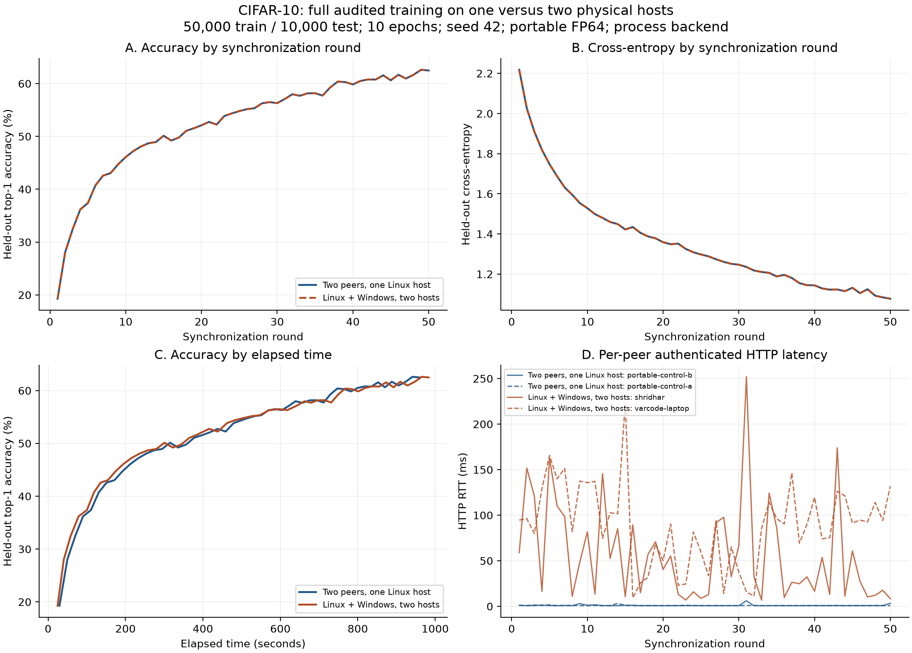

# Full CIFAR-10 experiment: single-system versus two-system training

Observed on 26 October 2026. This document records completed measurements for
technical evaluation and invention-disclosure supporting material.

## Result and scope

The full Linux–Windows experiment completed **10 epochs and 50 rounds**, using
all **50,000 training images and 10,000 test images**. It reached
**62.48% accuracy** in **984.694 seconds**.
Both peers completed all rounds and independently produced the same final model.

All **100 peer-to-peer contribution audits** passed. Across the saved round
records, the maximum weight audit error was `0.0` and the maximum
momentum audit error was `7.105427357601002e-15`. **50/50** aggregate round hashes
matched the single-system portable control.

This is one completed paired observation at seed 42, with different hardware and
operating systems between placements. It supports a working heterogeneous
peer-training prototype. It does not establish patent novelty, universal
correctness, a network-only cost, or statistically repeatable performance gains.

## Experiment design

Both placements used two equal peers and the same source, prepared dataset,
initial tensor bytes, seed, model, SGD settings, and audit policy. Each peer trained
its own disjoint shard, published its local state, independently replayed the
other peer's work, independently averaged contributions, and evaluated its result.
A proposing CLI started the run; no peer served as a permanent master.

| Setting | Both placements |
| --- | --- |
| Training / held-out images | 50,000 / 10,000 |
| Epochs / synchronization rounds | 10 / 50 |
| Model | Two convolution/pooling/ReLU stages (3→16→32), Linear(800→10); 22,058 parameters |
| Optimizer | SGD, learning rate 0.001, momentum 0.9 |
| Local batch / global synchronization size | 32 / 10,000 examples |
| Per-peer original training work | 5,000 examples per round; 250,000 over the run |
| Seed / PyTorch threads per peer | 42 / 1 |
| Numerical profile | `fp64-portable`; F64 arithmetic, F32 round/checkpoint serialization |
| Audit policy | Full independent replay of weights and optimizer momentum |
| Audit tolerance | `1e-6 + 1e-5 * abs(reference)`, unchanged |
| Backend | Trusted process execution |
| PyTorch / NumPy | 2.13.0+cpu / 2.5.2 |

The single-system control pinned its two peers to Linux logical CPUs 0 and 1.
The two-system run used Linux logical CPU 4 and Windows logical CPU 0. The
thread budgets match; the CPU assignments and physical processors differ.
The Linux host is an Intel Core i7-10510U with 8 logical CPUs and 7,764 MiB RAM.
The Windows peer advertised AMD64 Family 25 Model 80 Stepping 0, 16 logical CPUs,
and 15,773 MiB RAM. Linux used Python 3.13.7; Windows used Python 3.13.17.
The exact Windows processor marketing name was not captured.

Linux and Windows endpoints during the full experiment were
`172.16.203.242:9101` and `172.16.203.120:9101`. Both authenticated, advertised
resources, accepted inbound connections, and trained. These are historical LAN
addresses, not permanent identifiers. The single-system control used loopback.

## Measured comparison

| Metric | Two peers on one Linux system | One Linux peer + one Windows peer |
| --- | ---: | ---: |
| Top-1 accuracy (%) | 62.48 | 62.48 |
| Held-out cross-entropy | 1.077357 | 1.077357 |
| Macro F1 | 0.621097 | 0.621097 |
| Slowest peer wall time (s) | 959.115 | 984.694 |
| Effective global examples/s | 521.31 | 507.77 |
| Mean authenticated HTTP RTT (ms) | 0.947 | 72.573 |
| Pooled median HTTP RTT (ms) | 0.765 | 72.450 |
| Pooled observed HTTP RTT p95 (ms) | 1.670 | 151.703 |
| Training HTTP JSON body volume (MiB) | 22.574 | 22.766 |
| Sum of peer training times (s) | 572.785 | 504.359 |
| Sum of peer audit times (s) | 575.977 | 520.912 |
| Sum of peer evaluation times (s) | 757.415 | 678.006 |
| Sum of training CPU times (s) | 567.105 | 496.309 |
| Largest reported process peak RSS (MiB) | 549.23 | 553.90 |

The observed local-time / two-host-time ratio is **0.9740×**.
The two-host minus local accuracy difference is
**0.0000 percentage points**.
These are descriptive ratios from one pair of runs, not estimates of statistical
significance or effects attributable solely to network placement.

Effective throughput counts 500,000 original training examples divided by the
slowest peer's wall time. Replay audits incur additional computation excluded
from that numerator. Wall time includes training, audits, evaluation, networking,
and waits. Summed peer-seconds are concurrent costs, not extra sequential time.
No no-audit control was run here, so these timings cannot provide a causal
percentage overhead for auditing.

RTT is authenticated HTTP request/response latency, including server scheduling
and load; each placement records 50 samples per peer, 100 pooled observations.
The observed p95 is a sample percentile, not a guaranteed latency bound. Network
volume covers successful training HTTP JSON bodies including barrier polling;
it excludes discovery, dataset/initialization staging, headers, retransmissions,
and transport framing. Peak RSS is a process high-water measurement.

## Learning progression

The following rows select the last synchronization round of each epoch.

| Epoch | Single-system accuracy (%) | Two-system accuracy (%) | Single-system elapsed (s) | Two-system elapsed (s) |
| --- | ---: | ---: | ---: | ---: |
| 1 | 37.38 | 37.38 | 110.654 | 100.227 |
| 2 | 46.10 | 46.10 | 212.633 | 194.485 |
| 3 | 50.13 | 50.13 | 315.130 | 300.560 |
| 4 | 52.10 | 52.10 | 417.866 | 397.222 |
| 5 | 54.79 | 54.79 | 515.974 | 503.624 |
| 6 | 56.30 | 56.30 | 603.936 | 617.702 |
| 7 | 58.18 | 58.18 | 693.390 | 714.204 |
| 8 | 59.84 | 59.84 | 782.207 | 801.137 |
| 9 | 60.62 | 60.62 | 870.138 | 892.270 |
| 10 | 62.48 | 62.48 | 958.992 | 983.039 |

[Open the standalone visual comparison](../benchmarks/cifar/full-placement-comparison/comparison.html)
for accuracy/loss curves against elapsed time, RTT traces, per-class scores,
and confusion matrices. Machine-readable [CSV](../benchmarks/cifar/full-placement-comparison/comparison.csv)
and [JSON](../benchmarks/cifar/full-placement-comparison/comparison.json) accompany it.

## Integrity evidence and interruptions

Initial weight SHA-256: `1421fea18ecf18812c54879d5342430108fc31d6b96872cec7139fe36880815b`.

Single-system final model: `3dea161e29e5c7fe24a31a831ce2cca4ee346bf5b5b9550895bc0b8c2453f46d`.

Two-system final model: `3dea161e29e5c7fe24a31a831ce2cca4ee346bf5b5b9550895bc0b8c2453f46d`.

The initial collection command encountered a transient `No route to host` error.
Both peers continued training; authenticated checks confirmed progress, and the
collector was reattached to the same run. This was a monitoring-connection
interruption, not a restart or replacement of the distributed workload. Further
collector interruptions, if any, are retained in
[collection-notes.json](../benchmarks/cifar/full-two-host/collection-notes.json).
Any effects during the run are included in its observed timings; no interrupted
interval was removed to improve the result.

The full experiment used full replay audits of honest updates. It did not inject
malicious contributions, test selective audit rates, or measure adversarial
detection probability. Earlier protocol/corruption tests and the separate Linux
Firecracker isolation checks must be cited with their own scope and artifacts.

## Relationship to the invention disclosure

| Technical behavior | Evidence in this experiment | Boundary of that evidence |
| --- | --- | --- |
| Symmetric resource-sharing peers | Two independently addressed hosts advertise resources, accept connections, and train | Resource offers are metadata, not hardware attestation |
| Work and model agreement | Matching run configuration, data identity, shared initialization and model hashes | Fixed known CIFAR kernel; not arbitrary uploaded Python |
| Independent acceptance checks | Full replay of every other-peer contribution before aggregation | Honest-run evidence; not an adversarial detection-rate study |
| Cross-platform operation | Linux and Windows complete all 50 rounds | One tested CPU/software combination per host |
| Same-workload placement comparison | Full local control and full two-host measurement | Hardware, OS, CPU assignment and host load also differ |
| Volunteer isolation | Process backend recorded on both hosts | No end-to-end two-host Firecracker claim |

The earlier disclosure describes requester/volunteer arrangements and proposed
adaptive policies. The current CIFAR prototype implements equal peers and full
auditing. Do not describe unimplemented adaptive scheduling, selective auditing,
arbitrary workload admission, or failure reassignment as demonstrated by this
training experiment.

For stronger performance evidence, the next study should use multiple paired
seeds/repetitions, record comparable host load, and add explicitly scoped audit
and isolation controls. Those are follow-up experiments, not results implied by
this completed run.

## Exportable figures

[Vector PDF](../benchmarks/cifar/full-placement-comparison/full-experiment.pdf) ·
[Vector SVG](../benchmarks/cifar/full-placement-comparison/full-experiment.svg).
Accuracy and loss curves overlap because the aggregate model trajectory matches.
These plots show one paired observation, without uncertainty bands.

## Evidence package and reproduction

- [Full two-host observations](../benchmarks/cifar/full-two-host/experiment.json)
- [Full single-system portable control](../benchmarks/cifar/portable-reference/experiment.json)
- [Round-by-round agreement check](../benchmarks/cifar/full-two-host/trajectory-check.json)
- [Source and environment provenance](../benchmarks/cifar/full-two-host/provenance.json)
- [Shared initial checkpoint](../benchmarks/cifar/portable-reference/initial.json)
- [Setup and exact workload commands](cifar-experiments.md#reproducing-the-setups)
- [Earlier FP32 failure and portable-audit repair](cifar-audit-portability.md)
- [Separate Linux isolation and adversarial protocol tests](tested-lab.md)

Run IDs: local `3572dc8f3026f03b2e1d87b7`; two-host `c30c66da00ad46ed90695d21`.
Training-source SHA-256: `683b6304bdf4c90f0d58877b7a0de8edfcba9a0d8823c48177a263bdd306fb1d`.
Source revision at launch: `335751ea66a4f3cb7068778b691ae8ab56e5b935`.
